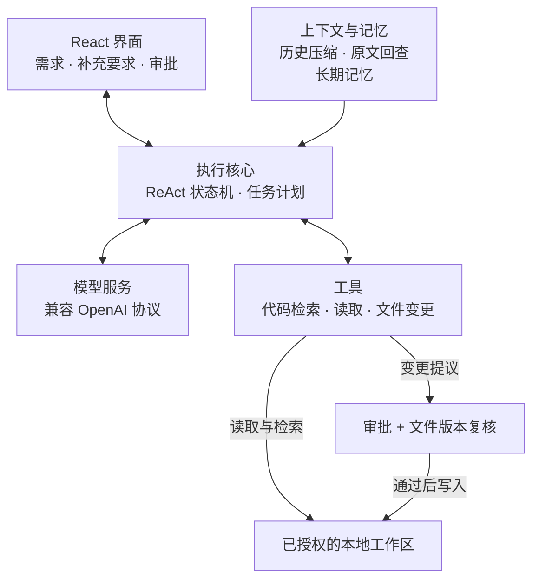
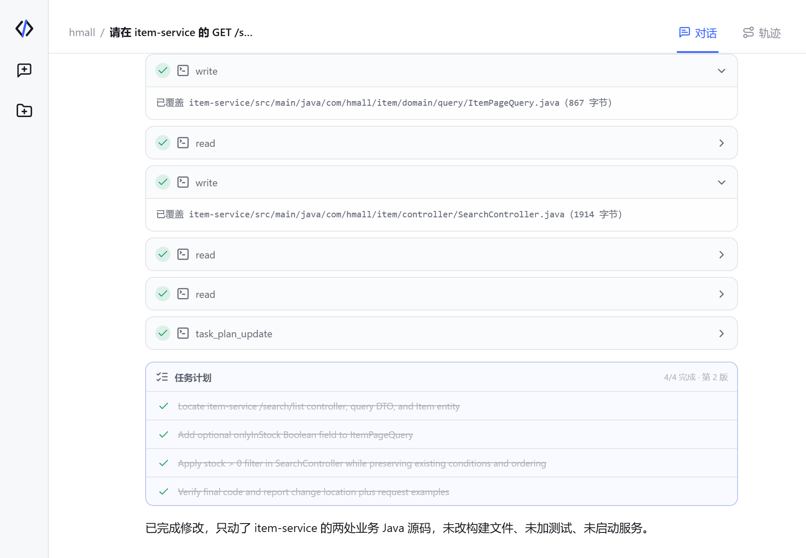

# CodeAgent · 本地编程智能体

CodeAgent 是面向本地代码仓库的编程智能体，支持代码问答、辅助编码与维护。用户提出需求后，系统查找相关实现、组织工具调用并按需修改文件；用户可以查看执行过程、在运行中补充要求，并审批待提交的变更。

**技术栈：** Java 21 · Spring Boot 3 / WebFlux · Project Reactor · React · TypeScript

## 设计概览

后端负责组织任务执行和管理状态，前端提供过程查看与用户介入的入口：



**让多步骤任务持续推进。** 执行核心通过 ReAct 循环，将工具结果带回下一轮模型判断，直到形成最终回答。结构化计划记录步骤与进度；用户补充的要求在当前工具批次结束后进入后续执行，便于协作中调整方向。

**为长任务提供合适的上下文。** 随着任务推进，相关代码和历史信息不断增加。代码检索结合关键词匹配与语义召回，并核验源码；历史压缩与工具原文回查控制上下文规模，长期记忆则用于跨会话复用偏好和项目约定。

**让文件变更可审查。** 修改先形成待审批的变更计划，批准后再检查工作区边界与文件版本。这样用户能参与修改决策，也能避免基于过期代码覆盖文件。

## 使用示例

以商品查询为例，提出一个带兼容性要求的小功能：

> 增加“仅看有货”的筛选条件，未开启时保持原有查询行为，同时保留现有筛选、分页与排序。

Agent 定位查询入口和参数模型，修改两处业务文件，随后回读代码并更新任务计划。下面展示文件修改阶段的执行记录：



*历史任务执行记录节选：文件写入、回读与计划更新。*

最终交付支持 `onlyInStock` 参数的查询实现，以及修改说明和请求示例。本例产物通过了库存筛选及原有查询行为的独立验收。

## 评测与回归

项目提供独立于日常对话的评测流程，使用固定任务与验收标准检查执行产物，比较不同版本的任务完成情况和已记录的执行成本。结合失败轨迹定位问题、补充回归案例，为提示词与执行策略调整提供依据。

## 快速开始

需要 Java 21、Node.js 和 pnpm 11.7.0。在仓库根目录分别打开两个终端，以下命令适用于 Windows PowerShell。

**启动后端：**

```powershell
cd backend
.\mvnw.cmd spring-boot:run
```

**启动前端：**

```powershell
cd web
pnpm install --frozen-lockfile
pnpm dev
```

打开 [http://127.0.0.1:5173](http://127.0.0.1:5173)，在「设置」中填写兼容 OpenAI 协议的 Base URL、API Key 和模型，再选择本地工作区开始使用。
